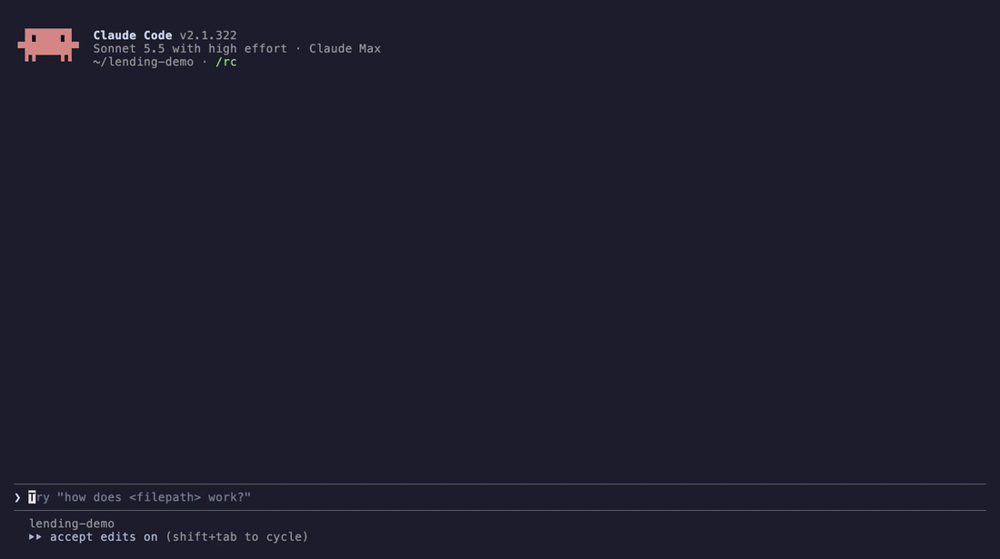

# Stele

*What you decided stays decided, whatever you ask your coding agent next.*



*A real Claude Code session on a small example project, with the waiting cut.*

1. **You say what the product must keep.** The agent writes it down as one requirement, and Stele checks it against every requirement approved before it.
2. **You approve it.** Claude Code asks you to allow the one command that records the approval, with Stele's summary in the prompt. Nothing is approved for you.
3. **A later request that cannot keep it is caught.** Stele hands the agent the approved requirements each request touches. The agent quotes the one in the way and asks you what should hold, before it edits anything.

Specs written months apart should not be allowed to disagree. Stele reads the requirements a project already writes (Spec Kit, OpenSpec, Kiro or plain Markdown). A project with no spec documents gets a `requirements/` folder its coding agent keeps, or uses the requests its agents declare with [Shale](https://github.com/provasign/shale). Stele turns each requirement into a checkable rule over one shared vocabulary, and finds requirements that contradict each other, however far apart they were written. Each contradiction comes back as a question for the project's owner, with a concrete example and what the code does today. From then on, every spec change is checked against every approved requirement before it merges, and what the owner decides is remembered in the repository.

**Preview.** Stele is open source and works with [Claude Code](https://claude.com/claude-code). The commands below work end to end on real repositories. Measured accuracy is uneven, and is stated in [what to expect](#what-to-expect). To try it on a project of your own, follow [Try Stele](docs/try-it.md): an hour, and what to send back.

Stele is one of three [Provasign](https://provasign.dev) tools for work done with coding agents, and each stands alone. Stele says what must stay true. [Prism](https://github.com/provasign/prism) shows the agent every place a change reaches before it edits. [Shale](https://github.com/provasign/shale) puts what the agent did on the pull request.

## Why

Spec-driven projects accumulate specs. Each is reviewed against whatever the reviewer remembers, and nothing re-reads last spring's spec when this autumn's lands. Coding agents then implement whatever they read. The case studies found this in each major spec format:

| Project | Format | What happened |
| --- | --- | --- |
| Project A | Spec Kit | 5 contradictions in the workspace lifecycle across four features; premature shutdowns in production |
| Project B | OpenSpec | Delta merges kept old requirements beside new ones; a resume path skipped a required check |
| Project C | Kiro | A new labeling spec needs a role the older user-management spec never offers, so no labeler account could be created |

## How it works

1. **Import.** `stele import` extracts every normative statement, with its source location.
2. **Translate.** Statements become rules over one vocabulary proposed for the whole corpus first, so one fact gets one name. A requirement Stele cannot express is reported, not dropped.
3. **Check its own reading.** Stele asks whether each rule covers every clause of its statement and no more, rereads statements whose rules contradict each other or block a step, and names what remains. The owner sees each requirement clause by clause, with the rule that checks it in plain words, or that nothing does.
4. **Find conflicts.** An LLM review of the whole corpus proposes contradictions; the SMT solver checks them against every approved rule and confirms those it can express, each with a situation in which the rules cannot all hold.
5. **Decide with the owner.** Each conflict is settled against the code first (which statement the code follows, and the lines that show it) and put to the owner as a question in the spec's own words. Answers become decision records.
6. **Gate changes.** `stele change` checks one spec change against every approved requirement, translating only what the change adds or edits. The owner approves the readings, which are pinned to the text, to the rule and to the vocabulary changes the approval accepts; `stele gate` blocks unapproved or conflicting rules.
7. **Learn.** The owner's answers are saved as lessons in the registry, committed with the specs, and every later check follows them.

## Quick start

```sh
curl -fsSL https://raw.githubusercontent.com/provasign/stele/main/install.sh | bash   # or: brew install provasign/tap/stele
cd your-repo && stele init
```

That is all you run. Stele supports [Claude Code](https://claude.com/claude-code) for now. `init` finds your spec format and writes Stele's short instructions and hooks for Claude Code; commit what it writes. From then on, Stele works through the agent:

- **When you ask for a change,** the agent gets the approved requirements it touches, so its plan keeps them or asks you before changing one.
- **In a project with no specs,** `init` sets up a `requirements/` folder. When you ask for something the product must keep ("from now on", "never", a limit, a default), the agent writes it there as one line and checks it before it builds. A one-off job is only a job, and Stele says nothing about it.
- **When specs change,** the agent runs Stele's check and asks you only what needs a person, in the specs' own words.
- **When a change is ready,** you approve it in one act. The agent shows the spec with Stele's summary under it and runs the command that approves; Claude Code asks you to allow it, with the summary in the prompt. Allowing it is the approval, and denying it records nothing. The prompt holds back an agent that would approve for you by mistake. It is not a security boundary.
- **When you commit,** a pre-commit hook blocks specs and approved requirements that disagree, and says what to run. It also blocks what it cannot check in a project with approved requirements (a registry or `stele.yaml` that does not load, a registry emptied or removed), and says how to restore it.
- **On a project with specs already,** the first commit that touches them says how to adopt: the agent reads every requirement once and asks you about each contradiction it finds. A large project can be adopted a few specs at a time (`stele adopt --spec`), and a contradiction can be recorded as open and decided later.
- **After an edit,** the agent hears which approved requirements the code change touches, by matching the code's names to each rule's step and attributes. That says where to look; it does not check the code against the rules.
- **After a merge or pull,** run `stele check` now and then. Each change was checked only against what its own branch held, so two changes approved on different branches can contradict each other once they meet. It checks every approved requirement against every other, with no model and in seconds, and names each contradiction in the requirements' words, with who approved each side.
- **On the pull request,** Stele commits a small card (`.stele/cards/<change>.json`): what the change does to the requirements, your decisions, and the approved requirements the code touches. Shale shows it on the PR.

**Without spec documents.** `stele init` gives a repository with no spec tool a `requirements/` folder of plain Markdown: one list item for each requirement, with an ID (`REQ-001`) and a MUST, MUST NOT, SHOULD or MAY. The agent writes them, you approve them, and `stele change markdown .` checks whatever the folder holds that you have not approved, from the first requirement on. In a repository that uses Shale and has no spec folder, `stele init` instead takes requirements from the requests the agents declare with `shale intent`. A request is a task, what the agent is about to do, and Stele says nothing about it. When you ask for something the product must keep from now on, the agent keeps that request as a requirement (`stele keep`, listed in `.stele/kept-intents.yaml`). Before it edits, Stele checks the kept request against every one approved before and asks you about any contradiction: change the new request, retire the earlier one, or restate both as one rule with its exception. Requests retired or set aside are listed in `.stele/retired-intents.yaml`; Shale's own evidence is never edited.

Stele needs the [Z3](https://github.com/Z3Prover/z3) solver on PATH; the installer tells you the command for your system. Its Claude Code hooks are Stele's own binary (`stele hook`), so nothing else needs installing. To build from source instead: `GOWORK=off go build -o bin/stele ./cmd/stele` (Go 1.26). `stele --help` lists the commands a project uses and `stele help all` every command; the [docs](docs/README.md) explain each step.

## With Shale

[Shale](https://github.com/provasign/shale) records what an agent did: the task it declared, the files and commands, the outcome. Stele records what must stay true. The owner is asked at one moment per feature.

**With a spec tool.** The agent drafts the spec change and runs Stele on it while it finishes the draft. You see the spec with Stele's summary under it and its questions in one round, and approve the spec and Stele's reading in one act. Planning and coding are silent: the hook tells the agent, not you, which approved requirements an edit touches, and the pre-commit check blocks only a commit that breaks one. The task names the change it implements (`shale intent --for <change-id>`), so the commit shows the requirement, the task and the code together on Shale's card.

**Without one.** The agent does the task and Shale records it; Stele says nothing. When a task states a lasting rule ("never delete a locked file", a default, a limit), the agent offers once, when the work is done, to keep it as a requirement; no means it is never offered again. Kept requests form the spec over time, and `stele export openspec` turns them into the project's first OpenSpec spec when it adopts the tool.

## What to expect

Measured on the case studies and held-out sets. These are single runs on small labelled sets, and a rerun can read a requirement differently.

- **On the case studies,** Stele shows its owner 9 of the 10 contradictions confirmed by hand in Projects A, B and C, before anything is approved. The tenth rests on a design note, not on a requirement Stele reads. All nine were found by the review of the texts and listed as possible; the solver proved none of them in these runs.
- **On two independently labelled sets** of 109 and 45 requirements, an adoption showed 20 of 20 and 10 of 13 known contradictions: 17 and 7 as solver-checked conflicts put to the owner, 3 and 3 listed as possible.
- **A conflict Stele reports as proved** is a solver-checked contradiction among the rules, with a situation in which they cannot all hold. One listed as possible comes from reading the texts and is for the owner to judge.
- **Reading requirements into rules** is the weak stage. On a blind-graded sample of 20 statements from a held-out project, 5 rules said exactly what their statement said, none misread it, and most of the rest said less. That is why the owner approves every reading, shown clause by clause with what checks it.
- **Settling from the code** was right in every verdict checked by hand.

**Cost.** The hooks never call a model. On two real registries, a request about specified behaviour added about 400 to 600 tokens of approved requirements to the agent's context (at most about 750), an unrelated request usually none, and each lookup took under 25 ms. Model spend comes only from reading specs: about 1.5 cents a requirement for short requirements (eight requirements for $0.13, 109 for about $1.50), and more for long ones with scenarios (the first check of a 179-requirement project cost $3.96 and took about ten minutes; a 126-requirement specification with long scenarios is estimated at $12 to $14); and `stele adopt` and `stele change` take `--max-cost` to cap it.

**What Stele keeps.** The approved requirements, the owner's approvals and lessons live in the registry, committed with your specs. While a change is open, Stele keeps its readings and your answers in `.stele/change/`, which is never committed and is removed when you approve. It keeps no copy of its prompts or the model's replies, except the calls of a reading that failed, until that change is approved. What it reads from the project reaches the model marked as material, never as instructions. `--max-cost` limits what a whole check may spend, and `--request-timeout` each model call.

**What a check means.** A reported conflict is proved for the rules as approved: they cannot all hold, and Stele shows a situation where they do not. "No conflict" is a statement about those rules, not about the prose, and holds within stated limits: each operation is checked one step from any state the invariants allow, so a conflict can sit in a state no sequence of steps reaches; collections and other instances of an entity are checked over a bounded number (3 by default); a solver timeout is `unknown`, never a pass. Stele does not prove the code implements the spec. [What a verdict means](docs/06-checker.md#what-a-verdict-means) states the semantics.

## How it compares

Checked against each tool's public documentation on 2026-11-09. Where a column says no, that is what the documentation showed, not a proof of absence. [Prior art](docs/prior-art.md#spec-tools-for-coding-agents) has the details.

| Tool | Finds contradicting requirements | Across how much | Checked by | Remembers what was decided |
| --- | --- | --- | --- | --- |
| Kiro Requirements Analysis | Yes, as two-option questions | One spec's requirements file | A model and a solver | The answer rewrites that file |
| Spec Kit `analyze` and `clarify` | As one item of a consistency pass | One feature and the constitution | A model | In that feature's spec |
| OpenSpec `validate` | No | Structure of one change | Rules of form | No |
| Stele | Yes, as questions with an example and what the code does | Every approved requirement in the repository, whenever it was written | A model proposes, a solver confirms | A registry of approved readings, decisions and lessons, in git |

Kiro does the closest thing, inside its own IDE and for one spec at a time, and it also derives property-based tests, which Stele does not. What Stele adds is the span and the memory. A requirement is checked against everything approved before it, in whichever of Spec Kit, OpenSpec, Kiro or Markdown the project writes. The approved readings live in the repository, so the check after next month's change starts from what the owner decided this month. It is open source, runs on your machine, and its gate and hooks need no model.

## Not yet

- Coding agents other than Claude Code.
- Running `stele gate` in GitHub Actions without setting it up yourself.
- Generating tests from the rules, and checking that a code change keeps the rules it touches (`stele touches` finds them by name only).
- Learning rules from the code itself, in projects with neither specs nor Shale.

What a first try runs into, from comparisons Stele cannot check to rereads that differ, is listed under [known limits](docs/try-it.md#known-limits). Report what confused you, or what Stele got wrong, in [GitHub issues](https://github.com/provasign/stele/issues).

## License

Apache-2.0. See [LICENSE](LICENSE) and [NOTICE](NOTICE).
