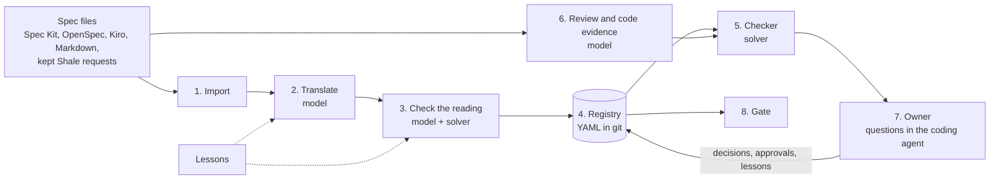

# 03. Architecture

Stele is one Go binary. A spec statement flows through import, translation and Stele's checks of its own reading into the registry; the checker and a review find conflicts; the owner decides them; and every later change goes through the same steps against the approved registry. Only the steps marked *model* call a language model; everything else is deterministic and runs with no API key.

## Components

### 1. Import (`internal/importer`)

Extracts each normative statement (MUST, SHALL, SHOULD, EARS criteria, OpenSpec requirements with their scenarios) with a stable ID and source anchor. An OpenSpec change folder is read as its added, modified, removed and renamed requirements. In a project without spec documents, the requests coding agents declare with Shale are tasks; only those kept as requirements (`stele keep`, listed in `.stele/kept-intents.yaml`) are read as specs.

### 2. Translate (`internal/vocab`, `internal/translate`, `internal/formalize`) — model

Turns statements into rules over declared vocabulary ([07](07-translation-and-grounding.md)). For a whole corpus, the facts are proposed over every statement first, so one fact gets one name; translation then runs in compact, checkpointed batches with statement-level repair. Each statement ends `translated`, `partial`, `informal`, `needs_vocabulary`, `obligation` or `invalid`, and the report says why. The owner's lessons reach every request as notes.

### 3. Check the reading (`internal/formalize`: cover, selfcheck) — model and solver

Before rules reach the registry, Stele checks its own translation: a judge asks which clause of each statement its rules cover and which rules go beyond it; the solver finds statements whose rules contradict each other or alone block a step. Each finding is read once more with the finding named; what remains is reported to the owner beside the reading.

### 4. Registry (`internal/ir`, `internal/lesson`)

YAML files in the project's repository, versioned with the specs: vocabulary, rules (each pinned to its statement's text and, once approved, to its reading), decision records, open conflicts from adoption, and lessons ([04](04-data-model.md)). One file per change, per lesson and per approval run, so parallel branches merge cleanly. A commit is a snapshot.

### 5. Checker (`internal/lower`, `internal/checker`, `internal/solver`) — solver

Lowers the registry to SMT-LIB over a transition system and asks Z3, per step and for the state, whether some situation leaves no valid response: conflicts, dead responses, vacuous rules ([06](06-checker.md)). Every finding has a counterexample. Results are cached per unit.

### 6. Review and code evidence (`internal/review`, `internal/adjudicate`, `internal/codegraph`) — model

`stele audit` asks a model to review the whole corpus for contradictions, then settles each candidate against the code: which statement the code follows, newer or older, with the lines that show it. Candidates the solver can model are confirmed with a counterexample (`stele candidates`, `stele confirm`). Code is read with Grove's embedded engine and `git grep` ([D-062](design-decisions.md)).

### 7. Owner (`internal/change`, agent skill and steering)

The owner decides in the coding agent, never by reading Stele's files ([D-058](design-decisions.md)). `stele change` returns questions in the spec's words, each with a recommended answer from the code where there is one; the agent answers Stele's own misreadings itself and asks the owner the rest. Answers become decision records, approvals and lessons. `stele init` installs this loop for Claude Code, the one agent supported for now.

### 8. Gate (`internal/gate`)

`stele gate` decides whether a registry change may merge: no new conflict, every touched rule approved for its current text and reading, no deleted rule. It is deterministic and needs no model.

## What calls a model

| Step | Model call | What checks it |
| --- | --- | --- |
| Translate | vocabulary and rules | compile errors repaired; coverage judge; solver self-check; the owner's approval |
| Coverage judge | which clauses rules cover | calibrated against hand-settled verdicts; its findings are shown, never applied silently |
| Review | candidate contradictions | the solver confirms what it can; the code settles; the owner decides |
| Code evidence | which statement the code follows | every verdict cites lines, which are checked to exist |

By default Stele's calls run on Claude Code, the agent it is run from, with the model that agent is using; the claude CLI, the Anthropic API or any stdin/stdout command can be named instead (`internal/llm`). A run can be capped by calls or by dollars.
