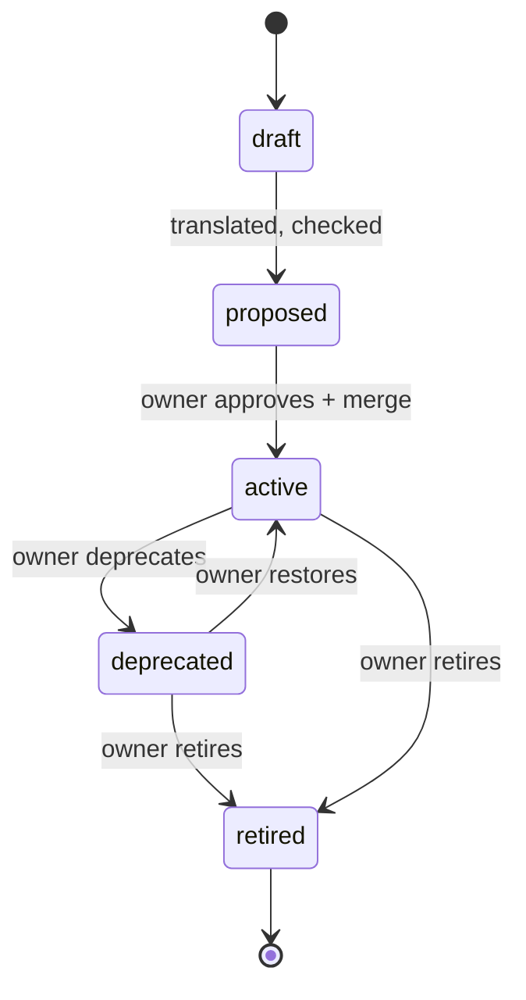

# 08. Key workflows

Six workflows cover the lifecycle. W2 is the reason the system exists; W6 is the same loop for a project with no spec documents.

Each registry has one owner: a person, or a group acting as one ([D-056](design-decisions.md)). The owner approves rules, vocabulary, decisions and the adoption baseline. There is one gate, `stele gate` in CI. Teams, per-context approvers and waivers are left out until a project needs them.

## W1. A spec change to approved rules

A change is checked as one unit, in the spec tool's own terms ([D-057](design-decisions.md), proposed):

| Format | Unit of change | Where the check runs |
| --- | --- | --- |
| OpenSpec | A change folder, `openspec/changes/<id>/`, whose specs list ADDED, MODIFIED and REMOVED requirements | Before the change is applied or archived. MODIFIED and REMOVED name the rules it replaces |
| Spec Kit | A feature folder, `specs/NNN-feature/` | After `/speckit.specify` or `/speckit.clarify`, before `/speckit.plan`. `/speckit.analyze` checks one feature; Stele checks it against every earlier feature |
| Kiro | A feature folder, `.kiro/specs/<feature>/` (EARS requirements) | A Kiro agent hook on save |

1. **Write.** The author writes or edits the spec in its usual tool, often with a coding agent.
2. **Translate the change.** Only new and changed statements are translated. Ambiguities and unknown terms come back as questions.
3. **Approve.** The owner reads each new or changed rule as plain English, with 3 to 5 solver examples including boundary cases, and approves or rejects it. Approval pins the rule to the statement's text hash. Re-translation never replaces an approved rule; only a changed statement goes back for approval.
4. **Check.** The checker runs the change against every approved rule: conflicts, gaps, invariants, vacuity, reachability. A conflict is reported in the tool's terms, for example "this MODIFIED requirement conflicts with capability X, requirement Y", with a counterexample.
5. **Decide.** The owner fixes the spec, or records a decision. When the new statement replaces old behaviour, the replacement is written into the old spec too: a MODIFIED delta in OpenSpec, an edit with a link in Spec Kit and Kiro. A stale statement left in place is how every case-study corpus went wrong.
6. **Gate.** CI runs `stele gate`. The change merges when it adds no conflict, every rule it touches is approved, and no approved rule's statement has changed since its approval.
This is built for OpenSpec change folders and for Spec Kit and Kiro feature branches. A branch's change is the difference between its specs and those at the base ref:

```sh
stele change speckit . --base main --json                       # or kiro; the change is named after the branch (<branch>-2 once one is approved)
stele change openspec . --list                                  # active change folders
stele change openspec . <change-id> --registry specs/registry   # steps 2 and 4; report.md in .stele/change/<id>, removed once the change is approved
stele change openspec . <change-id> --registry specs/registry --apply   # write the change's rules once it is clean
stele approve --registry specs/registry --base <main's registry> --by <owner>   # step 3
stele gate --base <main's registry> --head specs/registry      # step 6; blocks unapproved rules
```

The change is translated in compact mode over the registry's vocabulary plus the terms it proposes; a new term that may name an existing fact is compared with it, folded in when they are the same, and asked about when Stele cannot tell. A requirement whose text and notes have not changed keeps its earlier translation.

**Where the owner decides ([D-058](design-decisions.md)).** The owner never reads these files. A skill in the coding agent (Claude Code, the one agent supported for now) runs `stele change --json`, shows the owner the drafted spec with the check's `summary` under it, and asks the owner only what needs a person, in the spec's words, in one round:

- a new term that may mean an existing one: *"Cluster Teardown" says the cluster is torn down; is that the same as "infrastructure torn down" in the current spec?* A term with no near match is accepted without asking;
- a conflict: which requirement wins, whether one is an exception to the other, or whether the spec should be reworded;
- a likely rename: the change removes one requirement and adds another that reads much like it, with no RENAMED record. *Is "Hold guard" the same requirement as "Delete guard", renamed and edited?* "Same" keeps the rules' identity: a new version under their old IDs, so the decisions that cite them stay valid. A RENAMED record, with or without an edit, needs no question: the rules keep their IDs and move to the new title;
- the approval: *these 9 requirements are checked and consistent; approve?*

What the owner's answers teach stays: a same-term answer, "that situation cannot happen" and "you read that wrong" are saved as lessons in the registry (`lessons/`, one file each), committed with the change, and every later change and formalize run is read with them ([D-063](design-decisions.md), [04](04-data-model.md#lesson)). The approval question names the lessons a change adds.

A change usually needs 0 to 3 questions. The agent records each answer with `stele change answer` and checks again, which re-reads only what the answer affects; approving writes the change into the registry and records the approval. New terms are approved with the rules that use them. `stele init` sets the loop up for Claude Code: the skill in `.claude/skills/stele-change/` and a short Stele section in `CLAUDE.md`; see [integrations/skills/README.md](../integrations/skills/README.md). In CI, `stele gate` names anything unapproved and points back to the agent.

7. **Implement.** The coding agent gets the approved rules and their examples with its tasks (Spec Kit `/speckit.tasks` and `/speckit.implement`, Kiro tasks), so it writes tests for the boundary cases first.

## W2. Conflict with a rule written months earlier

The registry never compares documents. It checks each incoming rule against every approved rule in its slice.

1. **March.** A spec states R12: `deny Resource.delete when self.activeHolds > 0`.
2. **September.** A new spec says "users can remove their data at any time" to meet a data-erasure obligation.
3. Grounding maps "users" to `platform.Actor` and "remove their data" to `Resource.delete` through `synonyms.yaml`.
4. The translator emits R31: `allow Resource.delete when actor = self.owner and request.kind = erasure`. The owner approves it as a faithful reading of the new spec.
5. The checker finds a counterexample: owner, erasure request, `activeHolds = 1`. R12 denies, R31 allows. The two rules sit in different contexts, so in-context precedence does not apply ([D-001](design-decisions.md)).
6. The gate blocks the change. The owner sees R12, the spec it came from, its date and the counterexample in plain English.
7. The owner drafts D7: R31 supersedes R12 when `request.kind = erasure`.
8. The checker re-runs and now fails a different check: invariant R20 says a deleted resource has no active holds, and D7 lets a resource with active holds be deleted ([D-003](design-decisions.md)).
9. The owner adds a conditional effect to `Resource.delete`: under `erasure`, active holds move to the anonymized archive through `Hold.archive`, so `activeHolds` becomes 0.
10. The checker re-runs and passes. The owner approves D7, which pins `R31@1` and `R12@3`. The March spec gets a note that R31 supersedes it for erasure requests.

The age of R12 is irrelevant. What matters is that both rules are expressed over `Resource.delete`, and that the decision is checked against the invariants like any other change.

## W3. Vocabulary change

The main way W2 can fail is a new term that silently duplicates an old one, such as inventing `Resource.close` instead of using `Resource.delete`.

1. Any new entity, attribute, operation or enum value is a domain-model change the owner approves.
2. The compiler flags structural overlap: a new operation whose writes and effect match an existing one.
3. The owner must map the term as a synonym, define it in terms of existing symbols (`close := lock`), or justify it as distinct.
4. Once linked, the solver reasons across both.

### Enum value additions

Adding an enum value is not automatically additive. A new `status` value changes the meaning of every `status != x` guard and may create new states with only the default effect. When an approved rule references the attribute, the owner sees the semantic diff of the affected rules with the change ([D-019](design-decisions.md)).

## W4. Brownfield bootstrap (planned)

Not built yet: today a project without specs writes them first (a coding agent can draft them from the code for the owner to correct) and then adopts them as in W5. The design below is for mining rules from code. Mining is assisted and scoped, never automatic.

1. Extractors build the draft domain model ([07](07-translation-and-grounding.md#model-inference)).
2. Rule miners start from explicit policy sources: authorization middleware, OPA or Cedar policies, DB check constraints, feature-flag rules.
3. Each candidate rule is rendered in English with examples, its source location and a confidence, and sent to the owner.
4. The owner marks each as `intended`, `bug` or `unknown`.
5. Intended rules become the baseline snapshot. Bugs become tickets. Unknown rules stay `draft` and block nothing.
6. A coverage report lists API operations with no mined rule, so unknown logic is visible rather than assumed absent.
7. The checker runs on the baseline. Its first report is often the most valuable output: contradictions already living in the code.

## W5. Adopting an existing spec corpus

A project that already has specs (Spec Kit, OpenSpec, Kiro or plain Markdown) arrives inconsistent. Every corpus in the case studies held contradictions, mostly older statements that newer ones replaced without retiring them. W1 cannot start from such a corpus, because the gate blocks any conflict. W5 brings the corpus in once, records what it finds, and from then on blocks only new contradictions ([D-043](design-decisions.md) to D-047).

The spec files stay the source of truth. People keep editing them and agents keep reading them; Stele keeps its registry beside them, keyed to their statements ([D-043](design-decisions.md)).

### `stele adopt`: the path a project takes

From the coding agent, adoption is one command, run as a change against the empty registry and followed like any other change ([W1](#w1-a-spec-change-to-approved-rules)):

0. **Choose, on a large project.** On more than a hundred requirements in several specs, a bare `stele adopt` reads nothing: it answers with status `choose` and each spec's size and about what reading it takes, for the owner to pick from (`--all` reads everything). A check an agent runs also stops itself after eight minutes, under the agent's command limit, keeps its work and answers `continue`; the agent runs it again.
1. **Read.** `stele adopt` imports the specs and translates every requirement: the facts are named once over all of them, each requirement is translated, one that stops at a fact it lacks is read once more to declare it, and each reading is checked against its text and against itself ([07](07-translation-and-grounding.md)).
2. **A part at a time, if the owner wants.** `stele adopt --list` prints each spec with its number of requirements and whether it is read, with no model call. `stele adopt --spec <name>[,<name>]` reads only the specs named; a later run reads more of them, checked against what is approved. Each part's rules, vocabulary and open conflicts are files of their own in the registry (`adopted-<name>.yaml`, `conflicts/adoption-<name>.yaml`), and `adopted-specs.txt` lists the specs read. Until a spec is read Stele checks nothing in it, and a change that edits one of its requirements is still checked as a change.
3. **Before the owner is asked.** The model reviews the texts twice for contradictions, with no rules. A contradiction the review names and the rules do not show has its requirements read once more, told what the review saw; one the rules then show is a conflict like any other, and one they still do not is listed for the owner as possible before the approval (`possible_conflicts`), with no answer needed. Whether a contradiction is found therefore no longer rests on one reading of each requirement: on a labelled set of 45 requirements, two adoptions before this found 8 and 5 of 13 known contradictions, and two after showed 12 and 13. The rules of each conflict are checked against their own requirements' texts, and one that does not say what its text says is set aside. A step that sets a value is taken to keep the values a state rule ties to it. Where the code does what both requirements say, the agent has Stele read them once more.
4. **Questions.** What is left goes to the owner, each conflict with the answers that change nothing in the specs: one requirement is the exception to the other, recorded as precedence ([D-052](design-decisions.md)) and recommended when one is an error case or a check before the step; or "decide later", which records the conflict as open ([below](#open-conflicts-and-the-ratchet)).
   Only a conflict the review of the texts backs is asked. A clash that only Stele's rules show is Stele's to settle, in the same run: by precedence where one requirement is a check or an error case, else recorded as open under Stele's name, counted in the summary and the approval and listed in the report. So are the questions that concern Stele's modelling alone (whether a step makes a new instance, a reading that contradicts itself): an adoption has no rounds for the agent.
5. **Approval.** The owner approves the readings once. The registry is written, the specs as read become the snapshot that sync starts from, and `stele check` passes with the open conflicts tolerated.

Measured on a held-out project (one run each): the first check of 179 requirements took about ten minutes and $3.96 and asked its owner five conflicts, each with a recommendation; the adoption was approved after three rounds of answers for $5.41, with 135 requirements checked, 44 recorded unchecked and 11 conflicts left open. A spec of 46 requirements adopted on its own was approved with no question for its owner.

The steps below are the review-first pipeline this grew from (`stele review`, `confirm`, `triage`, `baseline`). Its commands remain, for a corpus too large or too inconsistent to translate whole, and its records (decisions, open conflicts, the snapshot) are the ones `stele adopt` writes.

### The review-first pipeline

1. **Import.** A format importer segments the corpus into statements, deterministically. Each statement gets a stable anchor, a hash of its text, and the date its text first appeared in git.
2. **Discover.** One LLM review of all statements lists candidate conflicts: sets of statements that cannot all hold, each with the situation named. A corpus too large for one prompt is reviewed by area in full text, plus once as a whole condensed to titles and normative sentences, so a contradiction between two areas shares a prompt with no retrieval step choosing what to pair (`stele review --budget-tokens`, [D-045](design-decisions.md)).
3. **Model around the candidates.** Vocabulary is proposed and statements are translated only for the candidates' statements, statements sharing their terms, and areas the owner selects. The rest stays unmodeled and blocks nothing ([lazy modeling](07-translation-and-grounding.md#lazy-modeling)), but it is not forgotten: the baseline records it as unaccounted debt.
4. **Confirm.** `stele confirm` runs the checker on the modeled part and marks each candidate:
   - **confirmed** when a checker finding cites all its statements, or a conflict lies within two or more of them; it comes with a counterexample and becomes a regression check;
   - **unproved** when one of its statements has no checked rule (informal, missing vocabulary, an open question);
   - **not reproduced** when every statement became a rule and the rules hold together. This is not a refutation: on Project B most such candidates were real contradictions the vocabulary or the translation missed ([evidence](#evidence-and-limits)).

   Every candidate goes on to triage whatever its mark; confirmation upgrades it to a proved conflict, it never dismisses one. Conflicts the checker finds that no candidate named are listed separately, after the candidates, because most are artifacts of a proposed vocabulary until a person has looked.
5. **Group.** Findings that share statements are shown together: the statement shared by the most findings roots the first group, and so on, so the owner reads root causes, not combinations (`stele triage`).
6. **Triage.** For each candidate, and for each checker conflict no candidate named, Stele drafts a decision from history: the most recently introduced statement supersedes the older ones where they conflict. The direction is drafted per checker conflict, among that conflict's statements only: on Project B X2 a finding cited three statements, and the middle one, which the code follows, beats the oldest and conflicts with nothing newer, so it must not lose because a newer statement shares the finding. The draft lists who supersedes whom, the rules accepting it would retire (the losing statements' rules in the checker's conflicts) and the rules reversing it would retire. A candidate the checker did not confirm retires no rule: accepting it records the supersession for write-back only. The owner sets each item to accept, reverse, open or dismiss, and may edit the rules first. Nothing is applied without approval ([D-046](design-decisions.md)). Statements introduced the same day, or with no git history, get no default direction. Rerunning triage keeps the decisions already made.
7. **Baseline.** `stele baseline` writes a decision for each accepted or reversed item that retires rules, checks the registry with them, and records every conflict and dead response left as an [open conflict](04-data-model.md#open-conflict), acknowledged by the owner named with `--by` ([D-044](design-decisions.md)). It refuses while items are pending, unless told to keep them open. A dismissed finding whose rules still conflict becomes an open conflict too: dismissing judges the finding, not the rules. It also records every statement not yet checked (no rule, `measured` rule or recorded review) as adoption debt. The ratchet lets that debt only shrink. An edited or new statement must be codified, reviewed, or recorded as an obligation naming the missing construct before merge, and an `informal` statement whose text changed needs a new review ([D-049](design-decisions.md)). The result passes the gate; any later conflict blocks.
8. **Write back (optional).** `stele writeback` adds a note beside each statement an accepted or reversed item supersedes (`> Stele T-12: superseded by 014/FR-009c where they conflict (decision D-T-12): …`), for a PR to the spec files. Agents read the prose, so a stale MUST must not stay unmarked there. Importers skip these notes, so the statement's text hash does not change.
9. **Sync.** Every later spec PR re-imports the changed files, and `stele sync` compares statements by anchor and hash with the ones the registry was built from:
   - a new statement goes through W1;
   - changed text is re-translated and bumps the rule's version, which makes decisions pinning the old version stale ([D-017](design-decisions.md)) and the open conflicts pinning it stale;
   - a moved statement (same text, new anchor) keeps its rule IDs and versions; `--apply` persists the new `source.statementId` and `source.doc`, so the next sync can still identify the original rules;
   - a removed statement retires its rules (`--apply`), and the open conflicts it was in report resolved.

Run sync with `--apply` before adopting the new statements file as the old snapshot for the next cycle. It preserves other source metadata and comments. Changed statements still require retranslation and a version bump; updating provenance does not approve a changed meaning.

### Coding CLIs and IDEs

Saved-spec synchronization is a shared engine exposed by `stele watch` and `stele lsp`. It detects saved edits, new files, moves, removals (including the final spec file), stale translated rules, and live rules whose source disappeared. It also catches stale/orphaned rules when someone advances the source snapshot prematurely. Generated registry documents are excluded from spec input. Watching is deterministic and invokes neither a model nor Z3.

Add a corpus to the project's existing `stele.yaml`:

```yaml
specs:
  root: specs/prose
  format: markdown
  snapshot: .stele/accepted-statements.yaml
```

These paths and the existing `registry` setting are relative to `stele.yaml`. Formats are `markdown`, `speckit`, `openspec` and `kiro`; for the last three, `root` is the repository root. The `kiro` format reads `.kiro/specs/*/requirements.md` and `bugfix.md` (not `design.md` or `tasks.md`), skips archived specs and the bug-analysis sections that describe current defective behavior, and adds the glossary definition of each term a statement uses. `anyCase: true` includes lowercase normative keywords for Markdown. The snapshot is the statement file underlying the accepted registry; before initial adoption, an empty `[]` snapshot makes every current statement pending. It must live outside the registry directory.

```sh
# Coding-tool post-edit command: JSON diagnostics and a delta translation queue.
stele watch --once --json --out .stele/pending.yaml

# CI or pre-commit: exit 1 for drift, 2 for a configuration/import error.
stele watch --once --check --json

# Continuous local feedback; stable content changes are debounced.
stele watch --json --out .stele/pending.yaml

# IDE transport: stdio JSON-RPC with Content-Length framing.
stele lsp
```

`--project DIR` resolves another project's configuration. Flags `--specs`, `--format`, `--old`, `--registry` and `--any-case` can override it. Queues are atomically replaced YAML files containing only added/changed statements; they cannot overwrite source Markdown, `stele.yaml`, the accepted snapshot or the live registry. Removals and ambiguous identities remain in the JSON action report. Detected moves require a mechanical provenance update, not translation.

The language server publishes native file diagnostics and clears them after a revert or a completed sync. It polls saved content, so it also catches edits made by coding CLIs, git operations and external tools. It advertises saved-file synchronization; unsaved editor buffers are not analyzed. The `stele.sync` LSP command returns the same status/action plan. Transport stdout contains only protocol frames. Configuration errors are reported as errors, never a clean status. Restart the server after changing configured corpus paths. One corpus is configured per server instance.

The local [VS Code client](../integrations/vscode/package.json) starts the server for each workspace folder containing `stele.yaml`, displays diagnostics in Problems, and provides **Stele: Check Saved Specs** and **Stele: Restart Spec Sync**. Set `stele.serverPath` to the Stele executable if it is not on the extension host's PATH. Build a local preview package with `python3 integrations/vscode/package.py --out /tmp/stele-spec-sync.vsix`, then use **Extensions: Install from VSIX**. This is a desktop/workspace extension; it is not a web extension. Its adapter smoke test uses the real server and a mocked VS Code API; an interactive editor session is a separate validation step. Other LSP clients can launch `stele lsp` with the project as their workspace root. The protocol follows the [LSP specification](https://microsoft.github.io/language-server-protocol/specifications/lsp/3.17/specification/), and the client supplies a standard [VS Code extension manifest](https://code.visualstudio.com/api/references/extension-manifest).

For Claude Code, `stele init` installs [stele-hook.js](../integrations/claude/stele-hook.js) in `.claude/hooks/` and merges its [hook configuration](../integrations/claude/settings.example.json) into `.claude/settings.json`, keeping other settings and hooks. `--hook=false` skips it, and `STELE_BIN` can point to an explicit binary. In a project whose `stele.yaml` names no specs, the hook says nothing.

The hook has two halves:

- **When the user submits a request (`UserPromptSubmit`),** it runs `stele rules` on the request. This is how planning is kept consistent with the approved specs: the agent gets the approved requirements the request touches, in the specs' own words, before it plans.
  - It matches the request's words against each rule's prose, weighting words by how rare they are among the rules. It also matches operations the request names, for example "stopping a workspace" for `Workspace.stop`.
  - It shows at most eight statements, plus a line for each named operation that has more rules than fit. That line tells the agent to run `stele rules --op <operation>`.
  - A request about nothing the specs say injects nothing.
  - The text calls them approved only when the owner approved every one shown; otherwise each one not yet approved is marked.
  - The injected text tells the agent that a plan must keep these requirements, and that where the request cannot be done without changing one it stops before any edit, quotes that requirement to the owner and asks what should hold. Nothing blocks at this point; the commit gate and CI block.
- **After writes, edits and shell commands (`PostToolUse`)** (including shell deletes and renames), it checks saved specs for drift and injects changed diagnostics into the agent's context. It suppresses identical repeated status, and reports recovery too.

Neither half starts a model, modifies approved rules, or prevents a file from being saved. The output uses Claude Code's documented [additional context](https://code.claude.com/docs/en/hooks). These are integration files, not changes to an already-running session. Other coding CLIs can call `stele rules` and the one-shot JSON command from their own hooks or task instructions; the CI check is the enforcement backstop.

This layer detects drift and prepares work. `in_sync` means no saved-source/provenance drift was found; it is not a coverage or conflict-freedom verdict. Translation/review must still replace affected rules with stable IDs and new versions, explicitly retire removed rules, and run the full registry checker/gate. Watching never advances the accepted snapshot or approves new meaning. Promote the new source snapshot only after those updates are accepted. Semantic conflict diagnostics for newly written prose require that downstream translation/check step; this adapter does not invent them from text changes.

### Commit hook

`stele init` installs a git pre-commit hook that runs `stele precommit`. It respects `core.hooksPath`, and it never replaces a hook it did not write: into another tool's shell hook it adds its own line after the shebang, and a hook that another interpreter runs (Python, Node) it leaves as it is and says what to add. It is quiet unless the commit stages spec or registry files. It blocks on what an approval clears:

- an approved rule whose statement text has changed or disappeared;
- a staged registry that `stele gate` refuses, checked against the registry in `HEAD`, as CI checks it: conflicts, unapproved rules, errors, and a step the solver could not decide that no approval accepts unchecked.

It also blocks, saying why, when the project has approved requirements and the commit cannot be checked: the registry does not load, the staged specs cannot be compared with it (the saved specs are missing from the commit), or the commit removes the registry.

A vocabulary change that alters what approved rules mean (a value's type, range or values, who sets it, what a step writes or does) leaves those rules unapproved until the owner's approval of the change names it: the approval records each such change on the rules it affects (`approvedChanges`), and `stele gate` and the hook refuse the registry without it. `stele change` records it with the change's approval. A registry edited by hand has no check to run: the hook names the vocabulary change and says to show it to the owner with `stele approve --registry <dir> --since HEAD --list`, record their approval with `stele approve --registry <dir> --since HEAD --by <owner>`, or undo it with `git checkout HEAD -- <dir>`.

Each message names the fix that fits: a deleted saved-specs file is restored with `git checkout HEAD -- <file>`; what a check can settle goes to `stele change`.

A new requirement the owner has not approved yet gets the command that checks it, without blocking: on a branch, the merge waits for the approval. In a Shale project, a commit to the base branch itself (`origin`'s default, else `main`) is blocked until the owner approves the requests it carries, since no later merge would hold them; a request the owner retired waits there for its replacement's approval too. Before the specs are adopted, a spec commit passes with the adoption command. Every message ends with the command to run, for the coding agent to act on. A clone without `stele` on PATH is not checked, and CI's gate remains the backstop.

### Resident checker

`stele serve` keeps the checker's work in memory. `stele check` uses it whenever one is running:

- **What the server keeps:**
  - each registry, loaded and lowered, until one of its YAML files changes size or modification time;
  - running z3 processes;
  - every unit's result. Results also persist one file per key in the user cache directory, so a one-shot `stele check` and CI reuse them too.
- **How the client uses it:**
  - It sends its own build identity. A server of another build refuses, and the client then checks by itself, so a stale server never answers.
  - It also checks by itself when no server is listening.
  - The answer is the same output and exit code a one-shot check gives.
- **Settings:**
  - The socket is `serve.sock` beside the cache directory. `STELE_SOCKET` overrides it.
  - `STELE_SERVE=off` makes the client check by itself.
  - `STELE_CACHE=off` keeps no persisted results, and `STELE_WARM_Z3=off` starts a z3 process per query.

```sh
stele serve &          # once per machine or session
stele check specs/registry
```

On Project A (446 rules), the server answers an unchanged registry in about 4 ms. Most of the 14 ms a client sees is starting the client process. A one-shot check without a server takes about 40 ms.

### Statement anchors

| Format | Statement | Anchor |
| --- | --- | --- |
| Spec Kit | `- **FR-xxx**:` bullet, or another line with a capitalised RFC 2119 keyword | Feature plus FR ID; current fallback for lines with no ID is a file/line anchor |
| OpenSpec | `### Requirement:` with its `#### Scenario:` blocks | Capability plus requirement title; repeated titles receive a line suffix |
| Kiro | EARS acceptance criterion under `### Requirement N`, or a numbered bugfix criterion | statement ID `<feature>/R<N>.<k>` (or `<feature>/2.1` in a bugfix); source `.kiro/specs/<feature>/requirements.md#L<line>` |
| Markdown | Line with a capitalised RFC 2119 keyword | Heading path plus ordinal |

An anchor with no ID in the source can move when lines are inserted. Sync matches unchanged text before treating a reused line anchor as an edit. Identical statements in the same file keep their occurrence order when their count is unchanged. A changed count or other ambiguous correspondence is reported, and `--apply` refuses to guess. A statement whose anchor and hash both changed appears as removed and added; the owner identifies whether it is the same statement.

### Open conflicts and the ratchet

An open conflict is an acknowledged conflict the baseline tolerates until someone resolves it ([D-044](design-decisions.md)).

- It pins the rule versions of one minimal conflicting set (or one dead response's core).
- The gate does not block a conflict whose minimal set is exactly an open conflict's pinned set. It blocks every other conflict, so the count can only stay or fall.
- Live, current open conflicts do not consume the enumeration limit. If enumeration of new conflicts is incomplete, the gate remains blocked even when every reported conflict is tolerated.
- Editing a pinned rule makes the record stale. If the conflict remains, it blocks like a new one; if it is gone, the gate reports the record resolved, to be closed (`status: closed`). Deleting the record is an error, like deleting a rule.
- Open conflicts are created only at adoption, approved by the owner: by `stele baseline`, or by the owner answering "Decide later" to a conflict question of `stele adopt`, which records that contradiction as open and lets the adoption be approved with it: the gate lists each one a change adds or re-pins for approval. Conflicts found later need a decision.
- Before the owner is asked about a conflict of a change or an adoption, two things are tried. First, each of its rules is checked against its own requirement's text, in one model call for all the conflicts: a rule that does not say what the text says (a condition turned round, a step required to run where the text only says what it does) is set aside, the requirement keeps its other rules, and the finding names what is no longer checked. Reading the requirement again instead gave a new reading that clashed elsewhere; setting a rule aside can only make the conflicts fewer. Second, where both requirements are in the change, the question offers one as the exception to the other, recorded as the rules' precedence ([D-052](design-decisions.md)) with no edit to the spec, and recommends it when one is an error case or a check before the step.
- At runtime the precedence order still applies. The open conflict is shown with its counterexample wherever its rules are shown, including the rule slices Prism gives agents.
- `stele check` lists open conflicts by age; the adoption report tracks their count over time.

### Snapshot, not replay

W5 ingests the corpus as it is now ([D-047](design-decisions.md)). Git dates order the statements for triage; the history is not replayed spec by spec. A replay attributes each conflict to the PR that introduced it, but needs a modeling pass per spec, and triage needs only which statement is newer. Replay remains an evaluation tool.

### Evidence and limits

On Project A specs 001–015, one LLM review call found 8 of 10 known contradictions with 8 findings; vocabulary proposal, translation and check found 7 of 10 with 69 findings, for about $7. The review is the better discovery step, at high reasoning effort: rerun on 2026-10-30, it found 3 to 5 of 10 at the claude CLI's default effort and 6 to 9 at high, for the same cost, so `stele review` defaults to high. The checker adds what the review lacks: a counterexample, a minimal set, a decision record and a regression gate. On Project B (OpenSpec, 756 requirements, about 800k prompt tokens), the batched review found all 3 known contradictions among 66 findings; X3 spans two areas and only the condensed pass found it. Modeling the 139 cited statements and checking them confirmed 21 of the 66, including 1 of the 3 known ones; 44 were not reproduced and 1 was unproved. Adjudicating all 66 against the spec text: 55 conflict as written (43 contradictions, 12 general-vs-specific pairs), 8 are wrong, 3 unclear. Every confirmed finding was real, and 33 of the 44 not-reproduced ones were real too, so the checker is the step that adds proof, not the step that decides what is real. Triage, baseline, write-back and sync then ran on Project B with decisions simulated from that adjudication, in under 30 seconds. The draft pointed X1–X3 at the statement the code follows, 15 decisions retired 23 rules, and 87 open conflicts let the baseline pass the gate. 68 notes written back changed no statement's hash. One run, one model; the review design was chosen knowing where X1–X3 sit.

## W6. Without spec documents: Shale requests

A project that writes no spec documents can still keep requirements. Its coding agents declare each task with Shale (`shale intent "<title>"`), and `stele init` reads those requests when `stele.yaml` says `format: shale`.

1. **A request is a task.** What the agent is about to do: a fix, a review, a feature. Stele says nothing about it, and the owner is not asked.
2. **Keep the lasting ones.** When the owner says something lasts ("from now on", "always", "never", a default or a limit), the agent keeps the request as a requirement before it builds (`stele keep --by agent`, recorded in `.stele/kept-intents.yaml`) and runs `stele change shale . --base <branch> --json`. The check, its questions and the approval follow W1.
3. **Offer once.** A request worded as a job that turns out to state a rule ("add a return command; only the holder can return a packet") is built first. When the work is done the agent offers, in one line, to keep the rule. A no is final: `stele keep <request> --decline` sets it aside, and it is never offered again. `stele keep --list` shows each request as kept, set aside or a task.
4. **Change a kept request** by declaring it again with `shale intent` in its new wording. The check asks whether the new one replaces the earlier one, is an exception to it, or takes precedence where they meet.
5. **Grow into a spec tool.** `stele export openspec` writes the kept requests as the project's first OpenSpec spec. The approved rules follow their statements under the new names, and Shale stays as the record of tasks.

Where Shale is installed in a project with a spec tool, the task that implements a spec change names it (`shale intent --for <change-id>`), and the pull-request card shows the requirement, the task and the code together.

## Rule lifecycle



| Status | Participates in checks | Conflicts | Notes |
| --- | --- | --- | --- |
| `draft` | No | — | Visible in the change only |
| `proposed` | Yes, in its own PR's slice | Error | Not yet in a snapshot |
| `active` | Yes | Error | Enforced at runtime |
| `deprecated` | Yes | Warning, dependants listed | Enforced at runtime until retired |
| `retired` | No | — | Kept for history, never deleted |

Editing an active rule bumps its `version`. Any decision pinning the old version becomes stale and the conflict re-opens ([D-017](design-decisions.md)).

**What an approval covers.** The owner approves a reading of a requirement, not the requirement's text. An approval is pinned to both: the hash of the text the rule was translated from, and the hash of the rule's reading (its kind, step, operation, subject, condition, assertion and precedence). Editing the text, or reading the same text into a different rule, needs approving again; the gate names the rule. Every approval is appended to `approvals.jsonl` next to the rule's file: who approved, when, the rule and version, and the reading approved, so a wrong rule can be traced to the approval that let it in.

**What the owner sees before approving.** `stele change` puts each requirement's text beside Stele's reading in the approval question: each rule in plain words (`in_words`) beside its rule syntax, and each clause of the text with what checks it or why nothing does (`clauses`). Beside them is what Stele's own checks still find in that reading after reading it once more: a clause no rule checks, a rule broader than the text, a rule that blocks a step ([07](07-translation-and-grounding.md#formalizing-a-corpus-from-prose), steps 6 and 7). A flagged reading makes the question recommend looking before approving. For a registry built by `stele formalize`, `stele approve --list` (`--json` for an agent) prints the same packet by requirement, with the reading each rule replaces when given `--base` or `--since <git ref>`, and the vocabulary changes the approval accepts.

## The owner

The owner is named once, in `stele.yaml` (planned; [D-056](design-decisions.md)). Handing a project over is an edit to that line. Approvals record who approved, so the history stays readable after a handover. Per-context approvers, delegation and orphan checks return only when a project with several teams needs them.
